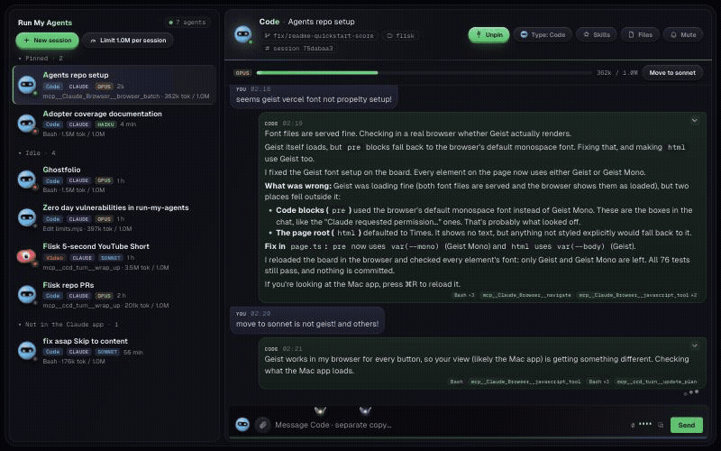

# Run My Agents

Run many Claude Code sessions on one repo, and stop them overwriting each other.



When one session is about to edit a file that another session on your computer edited in the last 10 minutes, the edit is stopped once with a note:

> Run My Agents: another Claude session (9d5f2846 on branch fix-login, in ~/code/app) edited api.ts 2 min ago. Your edit could overwrite its work. Read the file again first, or work on a different file. If you are sure, make the edit again and it will go through.

The agent re-reads the file and carries on. It is a warning, not a lock: a second try always goes through.

No server, no account, no keys. Everything stays in `~/.run-my-agents/claims.json` on your computer.

## Install

In Claude Code:

```
/plugin marketplace add flisk-sh/run-my-agents
/plugin install run-my-agents@run-my-agents
```

Then open two or more sessions on the same repo, or on worktrees of it, and work as usual.

## How it works

```
session A edits api.ts ──► claims.json { api.ts: A, 1 min ago }
session B edits api.ts ──► sees A's claim ──► edit stopped once, with a note
session B edits again  ──► goes through, B now holds the claim
```

A `PreToolUse` hook runs before `Edit`, `Write`, `MultiEdit` and `NotebookEdit`. Claims expire after 10 minutes.

## Settings

| Variable | Default | What it does |
|---|---|---|
| `RUN_MY_AGENTS_TTL_MINUTES` | `10` | How long an edit counts as "recent" |
| `RUN_MY_AGENTS_DIR` | `~/.run-my-agents` | Where claims are kept |
| `RUN_MY_AGENTS_MODE` | `warn` | `off` turns the warning off without uninstalling |
| `RUN_MY_AGENTS_IGNORE` | (none) | Extra comma-separated globs that never warn, like `*.snap,docs/gen/**`. Lockfiles, `*.generated.*`, `dist/` and `node_modules/` are always skipped |
| `RUN_MY_AGENTS_DEBUG` | (off) | `1` logs every decision and error to `debug.log` in the claims folder |

When a session ends, its claims are dropped, so a finished session never stops anyone.

## Limits

- One computer only. Sessions on other machines are not seen.
- Edits made through Bash (`sed`, `echo > file`) are not seen; only Claude's edit tools are.
- It matches whole files, not functions or lines.
- It warns, it never locks: a retry after a warning goes through. If the other session edits the file again after you were warned, you are warned again before your next edit, with its session, branch, age and when its claim drops.
- It needs `node` on your PATH.

## Test

```
bash test/test.sh
```

## License

MIT. Made by [Flisk](https://flisk.sh).

## The board: see all your agents

A local web page with every Claude Code session on your computer as a card: a face, what it is doing, the files it
touched, and a warning when two sessions edited the same file. It reads `~/.claude/projects`, so there is nothing to
sign in to, and it never leaves your computer.

```
cd services/app/board && bun install && bun start
```

Then open http://localhost:4100. It refreshes every 5 seconds. With [Flisk](https://github.com/flisk-sh/flisk), `flisk up` starts it as a local process.

## Token limits

Set a token limit per session on the board. When a Claude Code session passes it, the plugin stops it once and
tells it to move to the next cheaper model: Opus, then Sonnet, then Haiku. It never moves a model up. With
"move new sessions to a cheaper model" on, it also writes that model to the project's
`.claude/settings.local.json`, so new sessions there start on it. Limits live in `~/.run-my-agents/limits.json`.

## Other agents and skills

The board reads Codex sessions from `~/.codex/sessions` as well as Claude Code's. Each agent's Skills drawer suggests
skills for its job from the [DevEx Roadmap](https://roadmap.flisk.si) catalog (`bun scripts/skills.ts <roadmap checkout>`
refreshes `services/app/board/src/skills.json`).

## Mac app

[Download for macOS](https://github.com/flisk-sh/run-my-agents/releases/latest/download/Run-My-Agents-macOS.zip)
(Apple Silicon and Intel, macOS 13 or later). The board is built in, so it needs no Bun, Docker, Tilt or Flisk. It
is not notarized yet: the first time, open it from System Settings, Privacy & Security, Open Anyway. Every `v*` tag
builds and attaches a new one (`.github/workflows/release-mac.yml`).

`mac/build.sh` builds `mac/build/Run My Agents.app`: the board in a native window, plus a menu bar item. It starts
the board itself if nothing answers on port 4100. See [mac/README.md](mac/README.md).

## Develop

```
cd services/app/board && bun run dev
```

`bun run dev` restarts the board when its code changes, and an open board page reloads itself and keeps what you were typing (drafts are saved per agent in the browser).

## Pins and the right-click menu

Right-click an agent for its gauges panel: a token gauge, a model dial (Auto, Haiku, Sonnet, Opus), an effort gauge (low to max), switches for Pin and Mute, the agent type, and tiles to open its folder in Finder, Terminal or VS Code, plus copy buttons. The model and effort you set are used for every message the board sends to that agent (`claude --model --effort`); Claude Code cannot change a running session's model from outside, so the dial also copies `/model <name>` for the Claude app. Pins from the Claude app show as pinned too. Pins made in the board are saved in `~/.run-my-agents/pins.json` and never change the Claude app; unpinning here hides an app pin on this board only.

## Attach files

Click the paperclip in the message box, drop files anywhere on the board, or paste an image into the box. Files (up to 10 per message, 25 MB each) are saved in `~/.run-my-agents/uploads/<session>/`, outside your projects, and the message tells the agent where they are. Claude Code is also given that folder with `--add-dir` so it can read them.

## Drag, close, delete, pull requests

- **Drag agents** in the sidebar to reorder them. Drop one on Pinned to pin it, out of Pinned to unpin it, or into Closed to close it. Every move slides.
- **Close** hides an agent under Closed (nothing is deleted). **Delete** removes the transcript of a session the Claude app does not list, after a second click; sessions in the Claude app are never deleted from here.
- **Hover the branch** in the header to list its pull requests: the ones the Claude app attached, plus what `gh pr list` finds for the branch.
- **Click a model tag** (SONNET, OPUS, ...) to choose the model for messages you send from the board. The tag shows `SONNET -> HAIKU` until a board message has run on it, and the model really changes on the same conversation.

## Fonts

The board uses [Geist and Geist Mono](https://vercel.com/font) by Vercel, bundled in the app (SIL Open Font License 1.1, see `services/app/board/fonts/LICENSE-Geist.txt`), so it looks the same offline.
